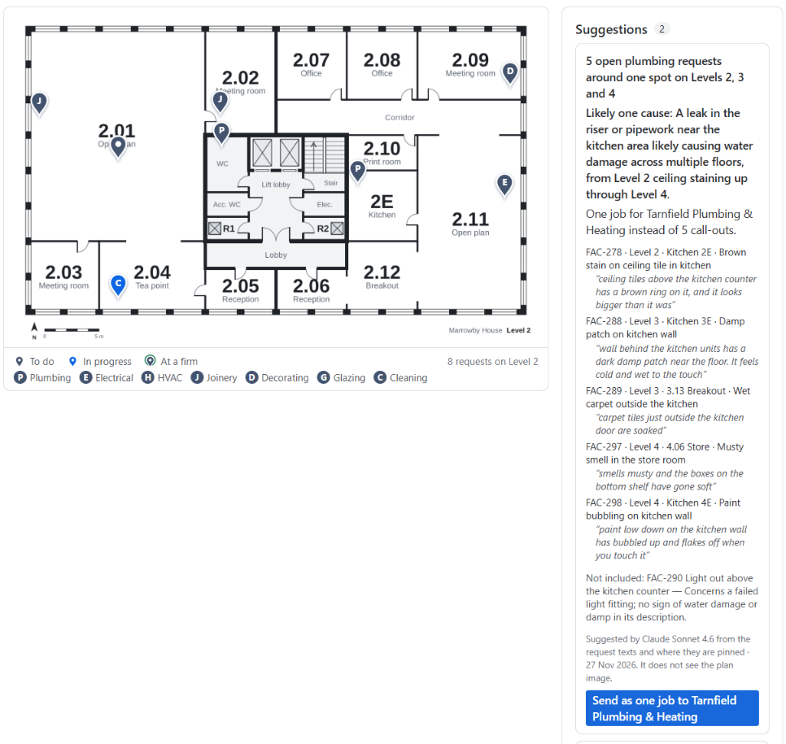

# Floorpin

Floor plans with pins for the requests tenants send to a property management team in Jira Service Management.

## Why

A request says which room. It does not say which other requests sit next to it, on the same floor or on the floors above and below. Five requests around one riser (a vertical pipe run) are five tickets and five call-outs in the queue; on the floor plan they point to one likely cause. Floorpin puts each request where the tenant saw the problem. An Atlassian partner describes such a setup: "JSM was then extended to Tenants by providing access to the Jira Service Management portal to submit maintenance requests" ([Moser Consulting, an Atlassian partner](https://www.moserit.com/atlassian-professional-services)).

## What it does

1. **A tenant pins the spot** on the portal request form.
2. **The team sees the floor**: open requests as pins, filtered by floor, status, kind of work and firm.
3. **Suggestions with reasons**: rules find three or more open requests of one kind around one spot, also across neighbouring floors; the model names the likely cause and quotes each request.
4. **One job to one firm**: "Send as one job to [firm]".
5. **The firm marks the job done** on any request page of the job in the portal.
6. **Confirm or return**, with a reason the firm and the tenant see. The page counts each firm's returns in the last 90 days.

**Your own building**: add a floor from your plan image, place requests on it and choose a firm for each kind of work.

## Try it

Install link, for a site admin: https://developer.atlassian.com/console/install/8271e83f-7a5d-4796-9951-f3f2ad5c1500?signature=AYABeNyV65FP%2BX5QuRGt95B4kHEAAAADAAdhd3Mta21zAEthcm46YXdzOmttczp1cy13ZXN0LTI6NzA5NTg3ODM1MjQzOmtleS83MDVlZDY3MC1mNTdjLTQxYjUtOWY5Yi1lM2YyZGNjMTQ2ZTcAuAECAQB4CxqLTo9l4lqXuFjNim1xJM%2Bp%2F3TVP9xHS2BrU5DRRucB0KM93ctF6TSS9MagSAY24AAAAH4wfAYJKoZIhvcNAQcGoG8wbQIBADBoBgkqhkiG9w0BBwEwHgYJYIZIAWUDBAEuMBEEDCuHkub2BImx1f9%2FZgIBEIA7%2F1IMcHwG3aZexORR6hdOgZ055gQzq0zja9VfQFW5wau8FNFVD3fSFZ%2BC5XX8V%2BNb3G%2FoyWrFGaGyWJYAB2F3cy1rbXMAS2Fybjphd3M6a21zOmV1LXdlc3QtMTo3MDk1ODc4MzUyNDM6a2V5LzQ2MzBjZTZiLTAwYzMtNGRlMi04NzdiLTYyN2UyMDYwZTVjYwC4AQICAHi9bVMAkme4qVQX1fQHo6ePw3H40A7cGfz7yrmSfBWMXgFG5eejSDvSJ347EJxulhO9AAAAfjB8BgkqhkiG9w0BBwagbzBtAgEAMGgGCSqGSIb3DQEHATAeBglghkgBZQMEAS4wEQQMCZFxAsw2NmUt25q%2FAgEQgDt5IckWVqMeraUHC4F91avlu%2BQjk%2FR25thym1454xfSd4%2FOPntiDe8bBupbUio2RRsulA7ICJqoVU7HcAAHYXdzLWttcwBLYXJuOmF3czprbXM6dXMtZWFzdC0xOjcwOTU4NzgzNTI0MzprZXkvNmMxMjBiYTAtNGNkNS00OTg1LWI4MmUtNDBhMDQ5NTJjYzU3ALgBAgIAeDYASx0XCjkny4iLV6vz%2BKtEGSGT6kdt0QRpkn6D%2FlVEAX5zqLG%2FdI%2BdLyC84%2BLGdWwAAAB%2BMHwGCSqGSIb3DQEHBqBvMG0CAQAwaAYJKoZIhvcNAQcBMB4GCWCGSAFlAwQBLjARBAxzhieviPd%2Bx1WS8zACARCAO64Riu5jaqxKis38wbD%2FVunWwwucdA3qOAijRNePvnirTQ7rWCprHZM30e0aXwdftj76O8LRBdLEPcUoAgAAAAAMAAAQAAAAAAAAAAAAAAAAACkgcOQ7U4faQWLb6q4YC0j%2F%2F%2F%2F%2FAAAAAQAAAAAAAAAAAAAAAQAAADK049hG7%2BljiSs6VjcoMi9yX%2BaRsCpBa1zdUNidAnI18qj8MfdJ9ahVpF4mpaSCio8hbk2nyPMqZ5J0LLngCGSDaxQ%3D&product=jira

The install screen lists six permissions; what goes to the model is under Model.

In a service project, open **Floor plan** in the project's sidebar items and click "Load sample building": in about a minute, three floors, 30 pinned requests and two suggestions. Walkthrough: [docs/JUDGES.md](docs/JUDGES.md).

## Model

The shared-cause suggestions come from a model called through Forge LLMs, Atlassian's API for [Atlassian-hosted models](https://developer.atlassian.com/platform/forge/runtime-reference/forge-llms-api/): the first of Claude Sonnet 4.6, Claude Sonnet 5 and Claude Haiku 4.5 active for the site, at temperature 0 where accepted. Each suggestion names the model. Only "Load sample building", "Check for shared causes" and "Check again" call it.

For each place of three or more open pinned requests, the model gets the floor names, up to five plan labels per floor and, per request, key, floor, room label, kind of work if a person set it, title and the first 600 characters of the description. Requests without a kind of work go in batches of up to 20 with key, title and those 600 characters. No plan images, pin positions, reporters, comments, attachments or organizations. Quotes are kept only if found word for word.

The developer pays for the calls, not the site. Spend limit per site: $0.60 after install, then $0.10 more each hour, at most $1.00 a UTC day and $3.00 in 30 days; a sample load costs about $0.04. Past the limit the page says "Suggestions from the model are paused for this site until [time]. Rules still work." The developer can switch the model suggestions off for one site, for new installations or for all sites; the page then says "Suggestions from the model are paused for this site. Rules still work." Without the model, Floorpin works by rules.

## What it needs

- Jira Service Management Cloud with a service project (**Facilities** on a `forge site provision` demo site).
- Forge LLMs, for model suggestions (on the demo sites tested it was available with nothing to switch on).
- A project administrator to load and remove the sample and choose the firms.

## Permissions and data

- **View Jira issue data**: requests and their properties, Jira search, plan images.
- **Create and manage issues**: pins, kinds of work, suggestions and jobs as issue properties; the request holding the plan images; the Organizations field; sample requests.
- **View Jira Service Management request data**: the service project, request types and fields, portal requests.
- **Create and manage Jira Service Management requests**: Floorpin's comments on requests.
- **Manage Jira Service Management customers and organizations**: organizations and their members; "View as" adds you to a sample firm until "Stop viewing as".
- **App Storage scope**: floors, the sample, the model's checks and spend, keys of requests created in the last half hour.

No account IDs, names or email addresses are stored; nothing goes to servers of the app's author. More in [PRIVACY.md](PRIVACY.md).

## Limitations

- In the new help center the portal home shows no Floorpin block; a firm sees its job on a request page, which "View as" opens.
- On a new site Jira search finds new requests late: about a minute in tests, nearly two days on one demo site. Sample requests and those of the last half hour are read by key.
- The Floor plan page reads requests again when you return to its tab, not continuously.
- A portal request page shows the job as it was when opened.
- "View as" works only for the sample's firms.
- The fit-out warranty and room labels come with the sample building. While the sample is loaded, its firms are used for all floors.
- Plans: PNG, JPG or WebP. A larger image is made smaller in the browser, to at most 2000 px on the longest side and 350,000 bytes.
- Up to 2,000 open requests per project.
- The reporter gets an email for each public comment Floorpin adds, three for a job returned once.
- Only a Jira administrator can delete organizations; for others, "Remove sample" unlinks the sample's organizations and leaves them on the site.

## Codegeist 2026

Built on Forge for Codegeist 2026, category Specialized Industries. The source code will be published in this repository with the submission.

Questions and problems: open an issue in this repository.
